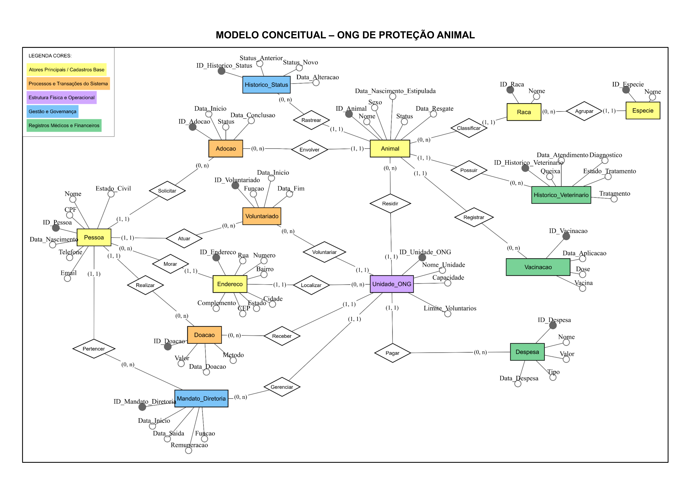
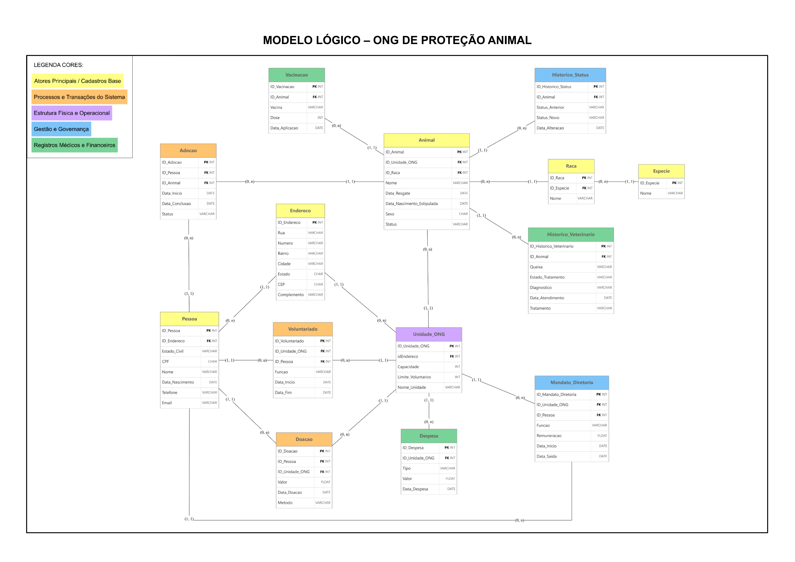

<div align="center">
  
  # Projeto Prático de Banco de Dados I
  
</div>

<div align="center">

  ## Sistema de Gestão para ONG de Proteção Animal

</div>

**Curso:** Tecnologia em Análise e Desenvolvimento de Sistemas (ADS) — FATEC Ribeirão Preto<br>
**Orientadora:** Profa. Me. Eliza Bomfim<br>
**SGBD:** Oracle Database<br>
**Integrantes:**
- [Ana Clara Almeida Barbosa](https://github.com/AnaBarbosa18)
- [Franciele Patrícia Nascimento da Silva](https://github.com/francielenascimento-hub)
- [Jordana dos Santos Pelis](https://github.com/m0biius2)
- [Samuel Pires Rodrigues](https://github.com/SamuelRod99)
- [Thiago Santana de Freitas](https://github.com/Thiaguin7)

---

<div align="center">

  ## SUMÁRIO

</div>

- [Contexto e Problema](#contexto-e-problema)
- [Público-alvo](#público-alvo)
- [Necessidades de Informação](#necessidades-de-informação)
- [Módulos e Estrutura do Banco de Dados](#módulos-e-estrutura-do-banco-de-dados)
- [Tecnologias e Recursos Utilizados](#tecnologias-e-recursos-utilizados)
- [Estrutura do Repositório](#estrutura-do-repositório)
- [Como Executar no Oracle](#como-executar-no-oracle)
- [Documentação](#documentação)
- [Modelo Conceitual](#modelo-conceitual)
- [Modelo Lógico Relacional](#modelo-lógico-relacional)
- [Justificativa da Normalização](#justificativa-da-normalização)
- [Dicionário de Dados](#dicionário-de-dados)
- [Regras de Negócio](#regras-de-negócio)
- [Carga Inicial de Dados](#carga-inicial-de-dados)
- [Operações de Atualização e Exclusão](#operações-de-atualização-e-exclusão)
- [Consultas SQL](#consultas-sql)
- [Objetos PL/SQL](#objetos-plsql)
- [Testes](#testes)

---

## Contexto e Problema 

<div align="justify">
  
ONGs de proteção animal recebem, ao longo do tempo, animais resgatados que precisam de tratamento veterinário, vacinação, abrigo e, por fim, de um lar. Ao mesmo tempo, dependem de doações, de voluntários e de uma diretoria
para funcionar. Em muitas organizações, essas informações ficam dispersas em planilhas, cadernos e mensagens de aplicativos, o que gera:

- dificuldade em saber a situação atual de cada animal (em tratamento, disponível, em processo de adoção, adotado);
- falta de histórico de vacinas e atendimentos veterinários;
- risco de duas adoções simultâneas para o mesmo animal;
- falta de controle sobre a lotação das unidades e o número de voluntários;
- pouca transparência sobre quanto foi arrecadado e quanto foi gasto.

Este projeto propõe um banco de dados relacional em Oracle que centraliza essas informações, garante sua consistência por meio de restrições de integridade e regras de negócio, e permite responder a perguntas de gestão por meio de consultas SQL.

</div>

---

## Público-alvo

<div align="justify">

O banco foi pensado para quem coordena a ONG no dia a dia:

- **Coordenação e diretoria:** acompanham animais, adoções, lotação das
  unidades, doações e despesas para tomar decisões e prestar contas.
- **Voluntários responsáveis pelo cadastro:** registram resgates, vacinas,
  atendimentos veterinários e escalas de voluntariado.
- **Responsável financeiro (tesoureiro):** consulta doações recebidas e
  despesas por unidade e por tipo.

</div>

---

## Necessidades de Informação

O banco deve responder, entre outras, às seguintes perguntas:

1. Quais animais estão disponíveis para adoção em cada unidade?
2. Qual é a situação atual (status) de cada animal e como ela mudou ao longo do tempo?
3. Quais adoções estão em análise, concluídas ou foram devolvidas?
4. Quais animais não possuem nenhuma vacina registrada?
5. Quais animais estão com tratamento veterinário em andamento?
6. Qual é a ocupação de cada unidade em relação à sua capacidade máxima?
7. Quantos voluntários ativos cada unidade possui, e em quais funções?
8. Qual o total arrecadado em doações por mês e por forma de pagamento?
9. Qual o total de despesas por unidade e por tipo?
10. Quem são os diretores atuais de cada unidade e em que função?

As consultas que respondem a essas perguntas estão em `04_consultas.sql`.

---

## Módulos e Estrutura do Banco de Dados 

A modelagem engloba 14 entidades principais organizadas nos seguintes fluxos operacionais: 

<div align="justify">

**Cadastros Base e Atores:** Gestão de Pessoas (Adotantes, Voluntários e Membros da Diretoria) e Animais resgatados.<br>
**Estrutura Operacional:** Controle de Unidades da ONG e capacidade máxima de alojamento.<br>
**Processos e Transações:** Gerenciamento dos fluxos de Adoção e escalas de Voluntariado.<br>
**Registros Médicos e Financeiros:** Acompanhamento do Histórico Veterinário, Carteira de Vacinação, recebimento de Doações e controle de Despesas da instituição.<br>

</div>

---

## Tecnologias e Recursos Utilizados 

<div align="justify">

**SGBD:** Oracle Database <br>
**Linguagem SQL (DDL e DML):** Criação de tabelas, chaves (PK/FK), restrições de integridade (`CHECK`, `NOT NULL`, `UNIQUE`) e manipulação de dados.<br>
**Lógica Procedimental (PL/SQL):** <br>
- **Triggers:** Automação de status de adoção e controle de capacidade das unidades.
- **Procedures:** Validação de regras de negócio complexas e cadastro seguro.
- **Functions:** Cálculos dinâmicos de doações acumuladas e despesas veterinárias.<br>

**Modelagem:** Diagrama Entidade-Relacionamento (DER) e Modelo Lógico Relacional normalizado (3FN).

</div>

---

## Estrutura do Repositório 

<div align="justify">

```text
.
└── main
  └──imagens
    ├── modelo-conceitual.png                        # DER
    └── modelo-logico.png                            # Modelo lógico/relacional
  ├── README.md
  ├── Modelo_Conceitual-ONG_de_Protecao_Animal.pdf   # DER
  ├── Modelo_Logico-ONG_de_Protecao_Animal.pdf       # Modelo lógico/relacional
  ├── Dicionario_de_Dados.md                         # Dicionário de dados
  ├── Regras_de_Negocio.md                           # Regras de negócio (RN01 a RN16)
  ├── 01_ddl_estrutura.sql                           # Tabelas, chaves e restrições
  ├── 02_dml_carga.sql                               # Carga de dados de teste
  ├── 03_dml_operacoes.sql                           # UPDATE e DELETE
  ├── 04_consultas.sql                               # Consultas e perguntas de negócio
  ├── 05_plsql.sql                                   # Procedures, functions e triggers
  └── 06_testes.sql                                  # Testes das regras de negócio
```

</div>

---

## Como Executar no Oracle

O projeto foi desenvolvido e testado no **Oracle FreeSQL** (ambiente web usado na disciplina), sem necessidade de instalação.

### Passo a passo

1. Acesse o FreeSQL e entre com sua conta.
2. Abra uma nova planilha (worksheet) em um ambiente limpo.
3. Execute os scripts **como script** (não como instrução única), na ordem:

| Ordem | Script | O que faz |
|:-----:|:-------|:----------|
| 1 | `01_ddl_estrutura.sql` | Cria tabelas, chaves, restrições e índices |
| 2 | `02_dml_carga.sql` | Insere os dados de teste |
| 3 | `03_dml_operacoes.sql` | Exemplos de `UPDATE` e `DELETE` |
| 4 | `04_consultas.sql` | Consultas de negócio |
| 5 | `05_plsql.sql` | Procedures, functions e triggers |
| 6 | `06_testes.sql` | Demonstração das regras de negócio |

### Verificação

```sql
-- Deve listar as 14 tabelas
SELECT table_name FROM user_tables ORDER BY table_name;

-- Objetos PL/SQL devem estar com STATUS = 'VALID'
SELECT object_name, object_type, status
FROM user_objects
WHERE object_type IN ('PROCEDURE', 'FUNCTION', 'TRIGGER');
```

### Reiniciar do zero

Para repetir a demonstração, remova as tabelas e objetos antes de rodar os scripts novamente (ver bloco de `DROP` no início do `01_ddl_estrutura.sql`).

---

## Documentação

- [DER (Modelo Conceitual)](Modelo_Conceitual-ONG_de_Protecao_Animal.pdf)
- [Modelo Lógico](Modelo_Logico-ONG_de_Protecao_Animal.pdf)
- [Dicionário de Dados](Dicionario_de_Dados.md)
- [Regras de Negócio](Regras_de_Negocio.md)

---

## Modelo Conceitual

### Modelo Conceitual do Projeto (MER)

O Modelo Conceitual do projeto foi desenvolvido para cobrir todo o ciclo operacional, médico e administrativo da instituição, estando organizado visualmente em 5 blocos funcionais/temáticos:<br>

<div align="justify">

🟨 *Atores Principais / Cadastros Base (Amarelo):* Formado pelas entidades Pessoa, Animal, Especie, Raca e Endereco. Modela os indivíduos cadastrados no sistema (adotantes, voluntários e diretores), os animais resgatados e a taxonomia básica.<br>
🟧 *Processos e Transações do Sistema (Laranja):* Engloba os relacionamentos transacionais Adocao, Voluntariado e Doacao. Gerencia o ciclo de adoções, as escalas de trabalho dos voluntários e as contribuições financeiras recebidas.<br>
🟪 *Estrutura Física e Operacional (Roxo):* Representado pela entidade Unidade_ONG, encarregada de registrar os abrigos e sedes físicas da ONG, controlando a capacidade de alojamento de animais e limites operacionais.<br>
🟦 *Gestão e Governança (Azul):* Composto por Mandato_Diretoria e Historico_Status. Controla os cargos administrativos da ONG e rastreia o histórico temporal das mudanças de estado do animal (ex: transição de EM_TRATAMENTO para DISPONIVEL ou ADOTADO).<br>
🟩 *Registros Médicos e Financeiros (Verde):* Formado por Historico_Veterinario, Vacinacao e Despesa. Armazena os atendimentos clínicos, prontuários veterinários, vacinas aplicadas e as despesas operacionais das unidades.<br>

</div>

### Diagrama de Entidade e Relacionamento (DER)



---

## Modelo Lógico Relacional

### Conceito: O que é o Modelo Lógico?

<div align="justify">

O Modelo Lógico (ou Relacional) representa a tradução do modelo conceitual para o modelo relacional de banco de dados. Ele converte entidades em tabelas, atributos em colunas com tipos de dados definidos (como VARCHAR2, NUMBER, DATE, CHAR) e estabelece a integridade referencial por meio de Chaves Primárias (PK) e Chaves Estrangeiras (FK). Nessa etapa, aplicam-se as Formas Normais (1FN, 2FN e 3FN) para eliminar redundâncias e evitar anomalias de inserção, alteração e exclusão.

</div>

### Modelo Lógico do Projeto (ONG de Proteção Animal)

<div align="justify">

Na conversão do DER para a estrutura relacional do projeto, as entidades e associações foram mapeadas conforme as seguintes diretrizes técnicas:

* **Mapeamento de Tabelas e Chaves:** Cada entidade do DER gerou uma tabela relacional dotada de chave primária (PK) auto-incremental (NUMBER / IDENTITY). As relações de cardinalidade `1:N` e `N:N` foram estruturadas pela inclusão de chaves estrangeiras (FK) nas tabelas dependentes (como ID_Animal em Vacinacao e Historico_Veterinario).

* **Normalização Aplicada:**
  * `Especie e Raca:` Foram separadas em tabelas próprias para eliminar a repetição de nomes de espécies/raças na tabela Animal (atendendo à 2FN e 3FN).
  * `Endereco:` Isolado em uma tabela dedicada, permitindo o compartilhamento e a padronização de localização entre Pessoa e Unidade_ONG.
  * `Historico_Status:` Tabela criada especificamente para auditoria e registro de histórico de transição de status dos animais.

* **Tipagem dos Atributos no Oracle:** Os tipos de dados foram especificados utilizando a sintaxe do Oracle Database: VARCHAR2 para textos descritivos, DATE para datas de eventos/resgates, CHAR para códigos de tamanho fixo (CPF, Sexo, Estado) e NUMBER(10,2) para valores monetários de doações e despesas. 

</div>



--- 

## Justificativa da Normalização 

<div align="justify">

O processo de normalização do banco de dados relacional foi conduzido rigorosamente para garantir a integridade dos dados, eliminar redundâncias desnecessárias e evitar anomalias de inserção, alteração e exclusão. As regras aplicadas contemplam as três primeiras formas normais (1FN, 2FN e 3FN), além de justificativas técnicas para redundâncias deliberadamente mantidas. 

</div>

### 1. Primeira Forma Normal (1FN) — Atributos Atômicos e Monovalorados 

<div align="justify">

* **Atomicidade dos Dados:** Todos os campos das 14 tabelas armazenam valores atômicos e indivisíveis.

* **Decomposição do Endereço:** O endereço não é armazenado como uma string concatenada. Ele foi isolado na tabela `ENDERECO`, decomposto nos atributos `Rua`, `Numero`, `Bairro`, `Cidade`, `Estado`, `CEP` e `Complemento`. 

* **Ausência de Grupos Repetitivos:** Informações multivaloradas (como múltiplas vacinas ou atendimentos veterinários de um mesmo animal) foram alocadas em tabelas próprias (`VACINACAO` e `HISTORICO_VETERINARIO`), relacionadas via chave estrangeira (`ID_Animal`). 

</div>

### 2. Segunda Forma Normal (2FN) — Dependência Funcional Total

<div align="justify">

* **Eliminação de Dependências Parciais:** Todas as tabelas possuem Chaves Primárias (`PK`) simples e bem definidas (utilizando chaves substitutas do tipo `IDENTITY`/`NUMBER`). 

* **Decomposição de Espécie e Raça:** Em vez de armazenar o nome da espécie e da raça diretamente na tabela `ANIMAL`, a taxonomia foi normalizada nas tabelas `ESPECIE` e `RACA`. Os atributos de `RACA` dependem funcionalmente apenas de `ID_Raca`, e `ANIMAL` faz referência somente a `ID_Raca`. 

</div>

### 3. Terceira Forma Normal (3FN) — Eliminação de Dependências Transitivas 

<div align="justify">

* **Eliminação de Atributos Transitivos:** Atributos não-chave dependem exclusivamente da Chave Primária da própria tabela. 

* **Normalização de Membros da Diretoria:** A tabela `MANDATO_DIRETORIA` armazena apenas a referência `ID_Pessoa`. O nome e os dados pessoais do diretor permanecem exclusivamente na tabela `PESSOA`, evitando a duplicação do nome em `MANDATO_DIRETORIA`. 

* **Compartilhamento de Endereço:** As tabelas `PESSOA` e `UNIDADE_ONG` não replicam colunas de localização; elas apenas contêm a chave estrangeira `ID_Endereco`, apontando para a tabela `ENDERECO`. 

</div>

### 4. Justificativa de Redundâncias Deliberadas 

<div align="justify">

* **Tabela `HISTORICO_STATUS`:** O status atual do animal fica registrado na coluna `Status` da tabela `ANIMAL`. No entanto, foi criada a tabela `HISTORICO_STATUS` para registrar `Status_Anterior`, `Status_Novo` e `Data_Alteracao`. Essa duplicação temporal é **deliberada e necessária para auditoria**, rastreabilidade do histórico de vida do animal resgatado e acionamento de gatilhos procedimentais (`TRIGGERS`). 

</div>

--- 

## Dicionário de Dados 

O dicionário descreve as **14 tabelas** do banco: colunas, tipos Oracle,
chaves, restrições e a regra de negócio ligada a cada coluna.

📄 **[Ver o Dicionário de Dados completo](Dicionario_de_Dados.md)**

| Grupo | Tabelas |
|:------|:--------|
| Cadastros base | `ENDERECO`, `ESPECIE`, `RACA`, `PESSOA`, `ANIMAL` |
| Estrutura e governança | `UNIDADE_ONG`, `MANDATO_DIRETORIA` |
| Processos | `ADOCAO`, `VOLUNTARIADO`, `DOACAO` |
| Registros médicos e financeiros | `VACINACAO`, `HISTORICO_VETERINARIO`, `DESPESA` |
| Auditoria | `HISTORICO_STATUS` |

---

## Regras de Negócio

O banco implementa **16 regras de negócio** (RN01 a RN16). Para cada uma, o
documento indica o que ela garante, **como** foi implementada
(restrição declarativa, modelagem, SQL ou PL/SQL) e onde está no código.

📄 **[Ver as Regras de Negócio completas](Regras_de_Negocio.md)**

| Mecanismo | Regras |
|:----------|:-------|
| Restrição declarativa (`NOT NULL`, `UNIQUE`, `CHECK`, `FK`) | RN01, RN02, RN04, RN05, RN06, RN14, RN16 |
| Índice único condicional | RN08, RN13 |
| PL/SQL (trigger/procedure) | RN03, RN07, RN09, RN10, RN11, RN12, RN15 |

---

## Carga Inicial de Dados 

A povoação inicial do banco de dados foi projetada para garantir volume e relevância técnica suficientes para a execução de relatórios, consultas complexas com `JOIN` e testes de restrições de integridade. 

Para respeitar as dependências de chaves estrangeiras (`FOREIGN KEY`), o script de inserção `02_dml_carga.sql` foi estruturado em **4 níveis hierárquicos sequenciais**:

1. **Nível 1 (Tabelas Base Independentes):** Inserção de dados nas tabelas `ENDERECO` e `ESPECIE`, que não possuem dependências externas.
2. **Nível 2 (Tabelas Dependentes do Nível 1):** Inserção nas tabelas `RACA`, `UNIDADE_ONG` e `PESSOA`.
3. **Nível 3 (Tabelas Operacionais e Transacionais):** Cadastro dos registros de `ANIMAL`, `MANDATO_DIRETORIA`, `DESPESA`, `VOLUNTARIADO` e `DOACAO`.
4. **Nível 4 (Tabelas Dependentes do Animal e Processos):** Lançamento de dados em `ADOCAO`, `VACINACAO`, `HISTORICO_VETERINARIO` e `HISTORICO_STATUS`. 

--- 

## Operações de Atualização e Exclusão 

O script `03_dml_operacoes.sql` reúne exemplos de manipulação de dados (`UPDATE` e `DELETE`) associados a situações reais do fluxo de trabalho da ONG de Proteção Animal. 

<br> 

### 1. Operações de Atualização (`UPDATE`)

* **Atualização de Status Clínico do Animal:**
  * *Pergunta de negócio:* Como atualizar o status de um animal que concluiu o tratamento médico para que ele fique disponível para adoção?
  * *Comando:* `UPDATE Animal SET Status = 'DISPONIVEL' WHERE ID_Animal = 2 AND Status = 'EM_TRATAMENTO';` 

* **Finalização Formal de Adoção:**
  * *Pergunta de negócio:* Como aprovar e concluir formalmente um processo de adoção em análise, registrando a data de conclusão?
  * *Comando:* `UPDATE Adocao SET Status = 'CONCLUIDA', Data_Conclusao = TO_DATE('2026-11-01', 'YYYY-MM-DD') WHERE ID_Adocao = 2 AND Status = 'EM_ANALISE';`

* **Encerramento de Vínculo de Voluntariado:**
  * *Pergunta de negócio:* Como registrar a data de encerramento do trabalho de um voluntário que se desligou da instituição?
  * *Comando:* `UPDATE Voluntariado SET Data_Fim = TO_DATE('2026-11-01', 'YYYY-MM-DD') WHERE ID_Voluntariado = 1 AND Data_Fim IS NULL;`

* **Manutenção Cadastral de Pessoas:**
  * *Pergunta de negócio:* Como atualizar os canais de contato (telefone e e-mail) de um doador ou voluntário cadastrado?
  * *Comando:* `UPDATE Pessoa SET Telefone = '16999998888', Email = 'ana.souza_atualizado@email.com' WHERE ID_Pessoa = 1;` 

<br> 

### 2. Operações de Exclusão (`DELETE`) 
* **Remoção de Adoção Cancelada:**
  * *Pergunta de negócio:* Como remover do banco de dados um registro de processo de adoção cancelado antes de sua efetivação?
  * *Comando:* `DELETE FROM Adocao WHERE ID_Adocao = 2 AND Status = 'CANCELADA';`

* **Exclusão de Despesa Indevida:**
  * *Pergunta de negócio:* Como apagar um lançamento financeiro de despesa cadastrado erroneamente?
  * *Comando:* `DELETE FROM Despesa WHERE ID_Despesa = 2;`

* **Estorno de Aplicação de Vacina Errônea:**
  * *Pergunta de negócio:* Como apagar o registro de uma dose de vacina lançada por engano no prontuário do animal?
  * *Comando:* `DELETE FROM Vacinacao WHERE ID_Vacinacao = 2;`

* **Limpeza de Prontuário Veterinário Duplicado:**
  * *Pergunta de negócio:* Como remover um histórico médico registrado em duplicidade?
  * *Comando:* `DELETE FROM Historico_Veterinario WHERE ID_Historico_Veterinario = 2;`

---

## Consultas SQL


---

## Objetos PL/SQL


---

## Testes
